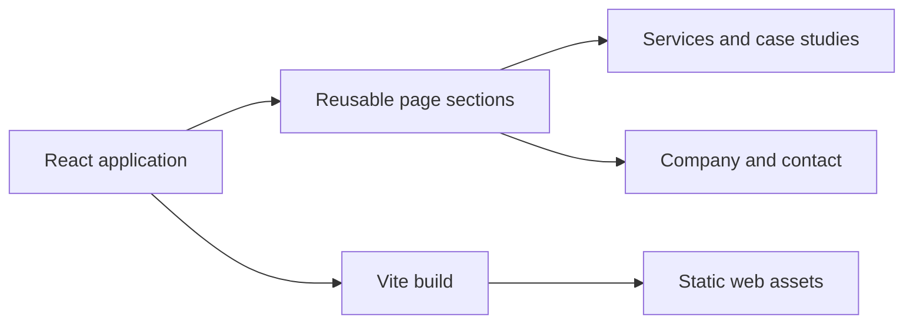

# DOTCOM — Software Solutions

**Independent software engineering, applied AI and secure digital systems.**

[Website](https://www.bydotcom.com) · [Engineering portfolio](https://github.com/emamoreno7)

## About

DOTCOM is the professional identity behind a portfolio of software architecture, enterprise applications, AI-assisted automation and cybersecurity research. This repository contains the public-facing company website, not the proprietary implementations of its products.

## Engineering portfolio

| Domain | Selected work |
| --- | --- |
| Applied AI | [Autonomous marketing and media orchestration](https://github.com/emamoreno7/emamoreno7/blob/main/showcase/autopilot.md) |
| Cybersecurity | [Local cyber intelligence and evidence validation](https://github.com/emamoreno7/emamoreno7/blob/main/showcase/cyber-intelligence.md) |
| Business systems | [Enterprise SaaS and transactional architecture](https://github.com/emamoreno7/emamoreno7/blob/main/showcase/enterprise-saas.md) |
| Privacy engineering | [Mobile security and on-device processing](https://github.com/emamoreno7/emamoreno7/blob/main/showcase/mobile-security.md) |

The case studies distinguish active research, prototypes and implemented functionality from future design goals.

## Website architecture

The site is a component-based React application, built with Vite, TypeScript and Tailwind CSS. Its sections communicate services, delivery process, selected cases and contact options.



## Local development

```bash
npm install
npm run dev
```

`npm run build` creates the production bundle. `npm run preview` previews the generated build locally.

## Contact

Software architecture, applied AI and engineering collaborations: [bydotcom.com](https://www.bydotcom.com).

**DOTCOM — Research & Engineering · Mendoza, Argentina**
